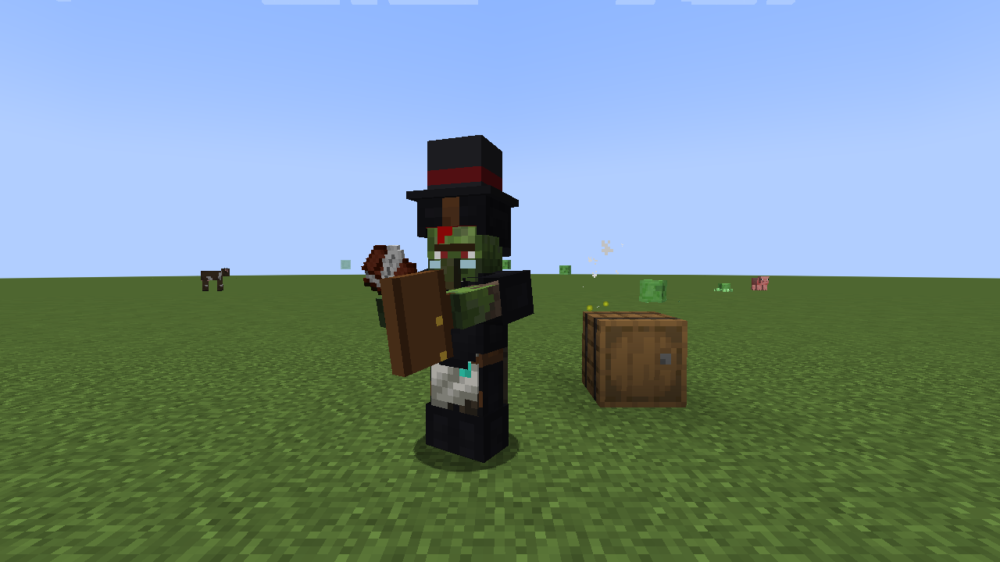
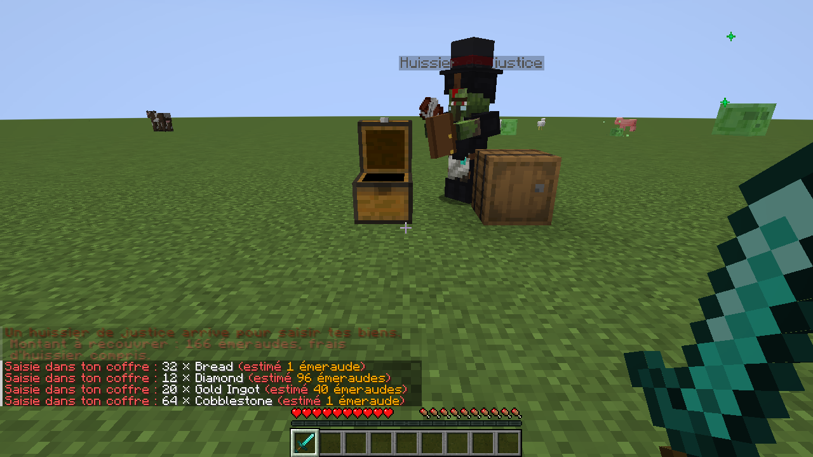
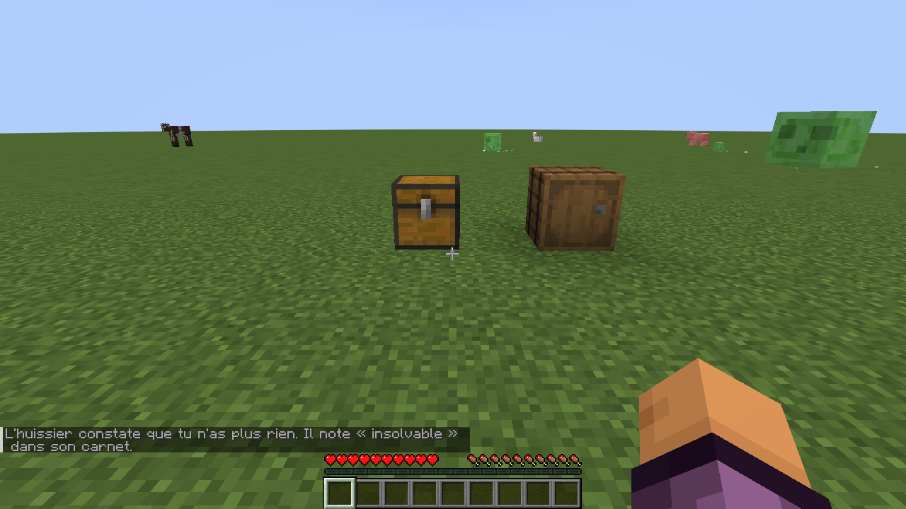
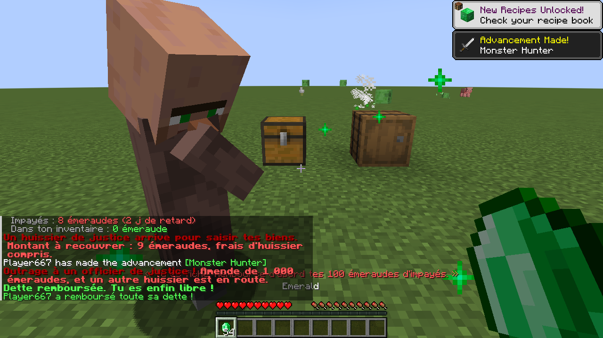

# Pauvreté

Mod Fabric pour Minecraft 1.20.1 à 26.3. Tu commences la partie avec **10 000 émeraudes de dette**. Chaque jour, les villageois prélèvent les intérêts dans ton inventaire, et si tu ne paies pas, un **huissier zombie** vient saisir tes coffres.



## La dette

À ta première connexion, la banque du village t'accorde d'office un prêt de 10 000 émeraudes à **1 % par jour**.

| Chaque matin | |
|---|---|
| Les intérêts s'ajoutent à la dette | 100 émeraudes le premier jour, puis un peu plus chaque jour |
| Prélèvement automatique | Les émeraudes sont prises directement dans ton inventaire, les blocs d'émeraude sont cassés et la monnaie rendue |
| Pas assez d'émeraudes ? | Incident de paiement : le reste passe en impayés |
| Les villageois accourent | Ceux du coin viennent te réclamer leur dû |

La dette ne disparaît pas quand tu meurs.

## Mauvais payeur

| Retard | Conséquence |
|---|---|
| 1 jour | Dernier avertissement. Prix **+25 %** |
| 2 jours | Un **huissier de justice** est envoyé. Prix **+50 %** |
| 4 jours | Tu es **fiché** : plus aucun villageois ne commerce avec toi |

## L'huissier

Un zombie en costume noir, avec son carnet, qui apparaît à une quinzaine de blocs et vient droit sur tes affaires :

1. il ajoute 10 % de **frais d'huissier** aux impayés ;
2. il fouille les **coffres et tonneaux** autour de toi et prend d'abord ce qui a le plus de valeur : netherite, diamants, or, objets enchantés… ;
3. s'il n'y a plus de coffre, il se sert **dans tes poches** ;
4. quand les impayés sont couverts, il range son carnet et repart. Si tu n'as plus rien, il te note « insolvable » et revient une demi-journée plus tard.

| Il arrive | Il se sert |
|---|---|
|  |  |

Il ne t'attaque pas, mais tu peux le tuer : tu récupères ce qu'il a saisi, mais sa valeur revient sur ta dette avec une **amende de 1 000 émeraudes** pour outrage, et un autre huissier est envoyé.

## Rembourser

- **Accroupi + clic droit** sur un villageois avec des émeraudes en main : la pile part au remboursement.
- Ou `/dette payer <montant>` à côté d'un villageois.

Les remboursements servent d'abord à éponger les impayés. Quand tout est remboursé, tout le serveur l'apprend.



## Commande

| Commande | Effet |
|---|---|
| `/dette` | Ton relevé de compte : dette, intérêts de demain, impayés, retard |
| `/dette payer <montant>` | Rembourser, près d'un villageois |
| `/dette <joueur>` | Le relevé d'un autre joueur (op) |
| `/dette set <joueur> <montant>` | Régler la dette (op) |
| `/dette jour <joueur>` | Faire passer un jour d'intérêts (op) |
| `/dette huissier <joueur>` | Envoyer l'huissier tout de suite (op) |

## Versions

| Minecraft | Téléchargement | Branche |
|---|---|---|
| 26.3 | [1.0.0+26.3](https://github.com/luuuccasss/poverty/releases/tag/1.0.0%2B26.3) | [`26.3`](https://github.com/luuuccasss/poverty/tree/26.3) |
| 26.1 – 26.2 | [1.0.0+26.1](https://github.com/luuuccasss/poverty/releases/tag/1.0.0%2B26.1) | [`26.1`](https://github.com/luuuccasss/poverty/tree/26.1) |
| 1.21.11 | [1.0.0+1.21.11](https://github.com/luuuccasss/poverty/releases/tag/1.0.0%2B1.21.11) | [`1.21.11`](https://github.com/luuuccasss/poverty/tree/1.21.11) |
| 1.21.6 – 1.21.8 | [1.0.0+1.21.8](https://github.com/luuuccasss/poverty/releases/tag/1.0.0%2B1.21.8) | [`1.21.8`](https://github.com/luuuccasss/poverty/tree/1.21.8) |
| 1.21.5 | [1.0.0+1.21.5](https://github.com/luuuccasss/poverty/releases/tag/1.0.0%2B1.21.5) | [`1.21.5`](https://github.com/luuuccasss/poverty/tree/1.21.5) |
| 1.21.2 – 1.21.4 | [1.0.0+1.21.4](https://github.com/luuuccasss/poverty/releases/tag/1.0.0%2B1.21.4) | [`1.21.4`](https://github.com/luuuccasss/poverty/tree/1.21.4) |
| 1.21 – 1.21.1 | [1.0.0+1.21.1](https://github.com/luuuccasss/poverty/releases/tag/1.0.0%2B1.21.1) | [`1.21.1`](https://github.com/luuuccasss/poverty/tree/1.21.1) |
| 1.20.1 | [1.0.0+1.20.1](https://github.com/luuuccasss/poverty/releases/tag/1.0.0%2B1.20.1) | [`1.20.1`](https://github.com/luuuccasss/poverty/tree/1.20.1) |

## Installation

1. Installer [Fabric Loader](https://fabricmc.net/use/) pour ta version de Minecraft.
2. Mettre [Fabric API](https://modrinth.com/mod/fabric-api) et le jar de ta version (tableau ci-dessus) dans le dossier `mods/`.

Le mod s'installe **sur le serveur**. Côté joueurs, il est **facultatif** : sans le mod, l'huissier est un zombie en costume ; avec le mod, il porte en plus un haut-de-forme et une mallette en 3D. Il marche aussi en solo.

## Compiler

```sh
./gradlew build
```

Le jar se trouve dans `build/libs/`. Le montant du prêt, le taux et les délais se règlent en haut de `Bank.java`, les prix des objets saisis dans `Appraisal.java`.
